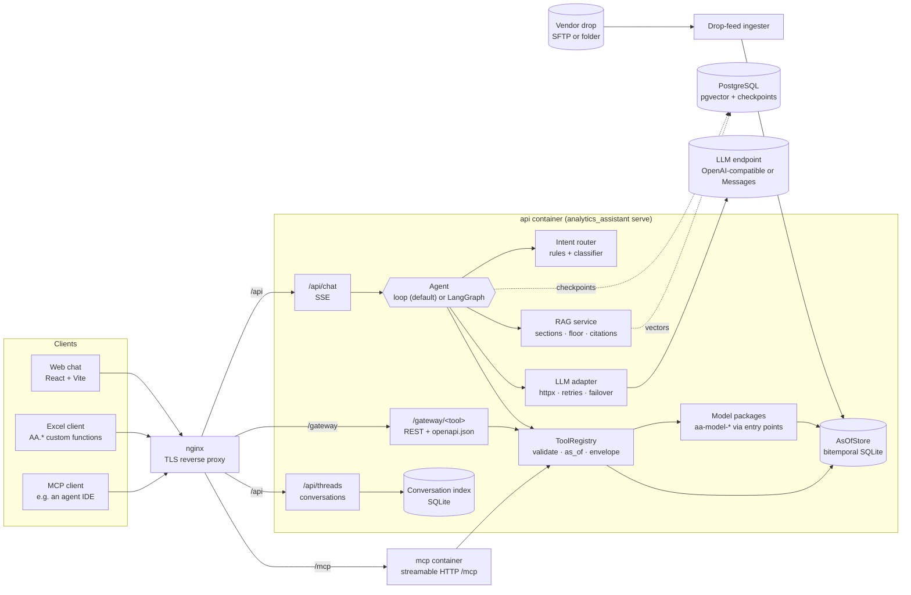

# Architecture

This document describes the structure of the Analytics Assistant and the
reasons behind its main design decisions, with the alternatives that were
considered. Models and data in this repository
are placeholders on synthetic data; the structure is what matters.

## Components



The same picture as text:

```
 browser ─┐                       ┌─► /api/chat ──► Agent (loop | graph) ──► LLM adapter ──► LLM
 Excel ───┼─► nginx (TLS) ────────┤        router ─┤ tool ──► ToolRegistry ──► model packages ──► AsOfStore
 MCP ─────┘    /  /api  /gateway  ├─► /gateway ─────┘ retrieval ──► RAG (pgvector | memory)        ▲
              /mcp                └─► /mcp (mcp container) ──► ToolRegistry          drop-feed ingester
```

Without Docker, all of this runs in one process (`python -m analytics_assistant
serve`) with SQLite and in-memory stores, and the web UI runs on the Vite dev
server, proxying `/api` to it.

## Request flow: a chat question

1. The browser posts `{message, thread_id, user}` to `/api/chat` with a
   bearer token. The server creates a thread id if none was sent, records
   the thread in the conversation index, and returns it in `X-Thread-Id`.
2. **Loop agent (default).** The agent builds the prompt (system rules:
   numbers only from tool results, cite as_of and snapshot_id; the user's
   stored preferences; the thread history; the tool catalog from the
   registry's JSON schemas), calls the LLM, runs each tool call through
   `ToolRegistry.call`, feeds the envelope back, and repeats until the LLM
   answers in text or `AA_AGENT_MAX_STEPS` runs out.
3. **Graph agent (`AA_AGENT=graph`).** The `router` node classifies the
   question (`tool`, `documents`, `refuse`). `tool` asks the LLM for tool
   calls and runs them through the same registry, looping while there is
   budget; `retrieval` searches the RAG service directly; `answer` writes a
   fixed refusal for `refuse` and lets the LLM compose the reply otherwise.
   The thread's messages are checkpointed after every node.
4. Every step is streamed as an event `{v, seq, run_id, thread_id, ts,
   type, data}` (`run.started`, `route.decided`, `tool.called`,
   `tool.result`, `message.completed`, `run.failed`, `run.finished`). The
   web UI reads the stream with `fetch`, renders text with React text nodes
   only, shows each tool call's arguments and envelope, and adds each
   result's provenance to the provenance panel.
5. `GET /api/threads/<id>` returns the transcript (user and assistant text,
   tool calls with their envelopes), read from the loop agent's history
   store or the graph's checkpoint, so a conversation can be resumed after
   a restart.

## Request flow: an Excel formula

1. `=AA.FORECAST("RATE_LONG", 5, A1)` converts the date cell (an Excel
   serial in the 1900 date system, where serial 60 is the non-existent
   1900-02-29) to an ISO date and calls `POST /gateway/forecast_series` with
   `{series, horizon, as_of}`. `=AA.REGIME` calls `detect_regime`;
   `=AA.TOOLS()` reads `GET /gateway/openapi.json`.
2. Identical requests from one recalculation burst (same tool and canonical
   arguments) share one HTTP call; distinct ones queue behind a limit of six
   in flight. Each attempt has a 30 s timeout; 429/502/503/504, network
   errors and timeouts are retried with exponential backoff and full jitter
   (honouring `Retry-After`) inside a 45 s budget. A cell Excel cancels
   leaves the queue, or aborts its request if it was the last one waiting.
3. The envelope is shaped into one rectangle: the result table, a blank row,
   then provenance rows (model id, version, as_of, snapshot_id,
   computed_at). Failures map by error code only: `#N/A` for
   `SNAPSHOT_UNAVAILABLE` and an unreachable gateway, `#VALUE!` for bad
   input, auth, `SCHEMA_VIOLATION`, `UNSUPPORTED_HORIZON` and server faults.

## Design decisions

### One registry behind every transport

**Decision.** MCP, REST and the in-process agent all call the same
`ToolRegistry.call`.

**Why.** When clients reach tools through different paths, argument
validation and error shapes drift apart by client. One entry point makes
"the same question gets the same answer" a property of the code, not of
discipline.

**Alternatives.** Expose MCP only and let REST clients use an MCP-to-OpenAPI
proxy. That works, but it adds a process and maps tool errors to HTTP 500, which hides the
difference between "your input is wrong" and "the server broke".

### Point-in-time data with explicit publication dates

**Decision.** Store `(series, obs_date, published_at, value)` and treat a
revision as a new row. Query by `as_of`.

**Why.** A model answer "as of" a past date must not use data that was
published, or revised, later. Without publication dates, a backtest or a
historical answer silently uses the final revised values, which were not
available at the time. The `snapshot_id` makes a result reproducible and
cacheable: equal ids mean equal inputs.

**Trade-off.** Storage grows with revisions, and every read is a
"latest row per key as of D" query. At this scale that is one indexed
`GROUP BY`; at a larger scale it would be a PostgreSQL table with an index
on `(series, obs_date, published_at)`.

### Refusals are data, not exceptions

**Decision.** Domain failures return `ok: false` with a stable code
(`SNAPSHOT_UNAVAILABLE`, `SCHEMA_VIOLATION`, `UNSUPPORTED_HORIZON`,
`MODEL_FAILURE`, `INTERNAL`); HTTP status codes are reserved for transport,
routing and auth.

**Why.** The agent needs to tell the user "no data was published by that
date" instead of retrying or guessing, and Excel needs to put that in a cell
as `#N/A` so `IFNA` can handle it. Clients map codes, never message text.

### Model plugins with failure isolation

**Decision.** Each model is its own installable package
(`packages/aa-model-ar1`, `packages/aa-model-regime`) with its own version,
discovered through the `analytics_assistant.models` entry-point group. The
server ships no models. The registry stamps the owning package's version
into the provenance of every result and lists each package, its version and
its tools in `health`. A plugin that fails to load (missing dependency, bad
artifact, duplicate tool name, empty tool list) is skipped and reported by
`health`; a model that raises at call time returns `MODEL_FAILURE` for its
own tool only.

**Why.** Models have heavy and conflicting dependencies and are released on
their own schedule. Keeping the server model-free means it can be built,
tested and deployed without any model installed, and one broken model
release removes only its own tools instead of taking the server down.

### Vendor drop feed: publication date from arrival

**Decision.** A vendor's daily CSV drop (SFTP in practice, a local folder in
tests) is loaded by `ingest/sftp_feed.py`. A row's `published_at` is the
date the file arrived, floored at the date it was loaded and at the feed's
latest publication. Rows are appended, never overwritten: a restated value
is a new revision row, an identical one writes nothing. Each file's SHA-256
goes into a ledger in the same transaction as its rows, so a re-run is a
no-op. A malformed file is copied to a quarantine folder with a reason and
recorded so it is not retried. A late original never supersedes a newer
restatement that was loaded before it.

**Why.** The date written inside a vendor file says what the value is
about, not when we could have known it; using it would put lookahead into
every backtest. Flooring at the load date means a file that sat unloaded
for days, or arrives with a back-dated timestamp, cannot change an answer
already given for an earlier as-of date. The trade-off is day granularity:
an as-of query for *today* can change when a file lands later today.

**Alternatives.** Overwrite in place (simple, but destroys the first-release
values that point-in-time answers need); trust the vendor's date (lookahead);
store intraday publication timestamps (removes the same-day caveat, at the
cost of a wider schema; a natural next step).

### Evals as the acceptance test

**Decision.** `evals/questions.yaml` lists generic analytics questions, each
with the route the agent must take (a tool, the documents, or a refusal),
the envelope code the first tool must return, and for documents the section
the top hit must come from. `evals/run_evals.py` runs them through the real
agent loop (or the graph agent), registry, model packages and store, and
also checks that every number in an answer appears in a tool result. Two
more suites measure the router (per-route precision and recall) and
retrieval (recall@k and abstention). CI fails under any threshold. See
[evaluation.md](evaluation.md).

**Why.** Unit tests check parts; the evals check the assembled behaviour a
user sees, including the rule that matters most: no number the tools did
not produce. The offline LLM is a deterministic keyword router, so the
evals run in CI without a key; `--live` runs the same set against a real
model.

### Conversational memory is separate from document retrieval

**Decision.** Two stores: a retrieval index for reference documents, scoped
by an allowlist of collections; and a preference memory for durable user
preferences only.

**Why.** Retrieval needs document lifecycle (idempotent re-ingest,
deletion, citations); memory needs per-user retention. Mixing them makes
both worse. Memory also refuses anything that looks like a dated level or
percentage: current values go stale and must always come from a tool with
an as-of date, never from what the assistant "remembers".

### A vendor-neutral LLM adapter over plain HTTP

**Decision.** One internal shape (`Completion`, `ToolCall(id, name,
arguments)`, `Usage`) and one `httpx` adapter that speaks both the
OpenAI-compatible chat format and the Anthropic Messages format, with
retries (exponential backoff with full jitter, `Retry-After` honoured,
non-retryable 4xx fail at once), timeouts, and failover to a second
configured provider. A check fails CI if any module other than the adapter
imports a vendor SDK. Offline, `ScriptedProvider` and a keyword router
stand in for the model.

**Why.** The agent, the router and the evals should not change when the
provider does. Plain HTTP keeps the dependency tree small, lets every test
mock the transport, and puts retry and failover policy in one place that
we control and can test without sleeping. Error messages carry the status
and provider label only, never a response body.

**Alternatives.** Vendor SDKs (typed, but one dependency and one retry
policy per vendor, and harder to mock at the transport); a gateway library
that wraps many providers (broad coverage, but a large dependency whose
retry and error semantics we do not own); an external LLM proxy service
(good for many teams sharing keys and budgets, one more service to run here).

### Intent routing before the agent

**Decision.** A router with three routes (numbers to tools, explanations
to documents, out of scope refused): regular-expression rules first, then
an optional naive Bayes classifier trained on its own examples, and on
uncertainty a numeric-looking question goes to the tool route. A labelled
set of 46 questions reports per-route precision and recall in the evals.

**Why.** Routing is the decision users notice most when it is wrong. As a
separate component it can be measured on its own, the refuse route costs
no LLM call, and the retrieval route needs no LLM call to decide to
search. The numeric bias is deliberate: a tool refuses with a stable code
when it cannot answer, which is recoverable; a confident answer from the
documents to a numeric question is not.

**Alternatives.** Let the LLM choose among all tools including retrieval
(simplest, and the loop agent does this; but routing quality then depends
on the model and is hard to test offline); an LLM call as a classifier
(more accurate on odd phrasings, one extra call per turn); embedding
similarity to labelled examples (no rules to maintain, needs a semantic
embedder to beat the rules).

### LangGraph as an option, not a replacement

**Decision.** `GraphAgent` implements the same `run()` event stream and
`history()` as the loop agent, as a LangGraph `StateGraph`
(`router -> tool | retrieval | answer`) over the same `ToolRegistry`, with
a checkpointer chosen by configuration: Postgres when `AA_DATABASE_URL` is
set, SQLite in `AA_STATE_DB`, memory in tests. `AA_AGENT=graph` selects it;
the loop stays the default.

**Why.** The graph makes control flow explicit (which node ran, why it
went there) and checkpoints give durable, resumable threads for free. The
loop is fewer moving parts and has no extra dependency, which is the right
default for a laptop and for CI. Keeping both behind one interface lets the
question set run through each (both score 30/30 offline), so a change that
breaks one shows up immediately.

**Alternatives.** Graph only (one code path, but every install needs
LangGraph); a hand-written state machine with our own persistence (no
dependency, but checkpointing and resumption are real work); a hosted
agent runtime (less to operate, less control over data and cost).

### Retrieval: sections, a floor, and a store interface

**Decision.** Documents are loaded as sections (markdown headings, PDF
pages), chunked with overlap, embedded with a pluggable embedder (offline
hashing by default) and stored behind a `VectorStore` interface (in memory
by default, pgvector with an HNSW cosine index when Postgres is
configured). Every hit carries a citation (`doc_id`, `section`, `chunk`).
Below a similarity floor the search returns nothing and the agent says it
does not know.

**Why.** A section is what a reader can check, so it is the unit of
citation. The floor is the cheapest guard against answering from the
least-bad match. pgvector keeps vectors next to the checkpoints in one
database the stack already runs.

**Alternatives.** A dedicated vector database (more features and scale,
one more service); hybrid keyword + vector search with a re-ranker (better
recall on identifiers and rare terms; the natural next step); a hosted
embedding API (better semantics, a network dependency and a per-call cost).

### The web front end reads SSE with fetch

**Decision.** React + TypeScript + Vite. The chat request is a POST with a
bearer token, which the browser's `EventSource` cannot send, so the UI
reads the response body with `fetch` and an incremental SSE parser. The UI
is served from the same origin as the API (Vite proxy in development,
nginx in Docker). Model text is rendered as text nodes only.

**Why.** Same origin means no CORS for the UI and the token never travels
to another host. Rendering as text removes the main injection path from
model output; nginx's Content-Security-Policy is the second layer.

**Alternatives.** `EventSource` with the token in a query string (leaks
into logs and history) or a cookie session (needs CSRF protection and a
login flow); WebSockets (bidirectional, not needed for one-way streaming,
and harder to proxy and debug); rendering markdown (nicer output, needs a
sanitiser and a review of every allowed tag).

### One compose stack, one TLS entry point

**Decision.** `postgres` (pgvector), `api`, `mcp`, `web` and `nginx`.
Only nginx publishes ports, on 127.0.0.1, with a self-signed certificate
generated by a script. Health checks gate start-up order; `api` seeds the
shared store before `mcp` starts.

**Why.** It is the smallest production-shaped deployment: TLS, a single
origin, internal-only services, and a real database for vectors and
checkpoints, all reproducible with one command.

**Alternatives.** One container for everything (simpler, but the MCP
server and the UI cannot scale or restart independently); Kubernetes
manifests (the right target for a team, more than a reference build
needs); a managed platform (less to run, provider-specific).

### Observability: traces, counters and JSON logs

**Decision.** OpenTelemetry spans around agent runs, tool calls,
retrieval and LLM calls; token and cost counters; JSON logs with a request
id on every line. Span attributes are an allowlist (ids, names, counts,
codes); a redaction filter masks tokens and keys in every log line.

**Why.** An LLM application fails in new places (a slow provider, a
retried call, a tool that keeps refusing). Traces show where; counters
show what it cost; request ids join a user's report to the lines that
explain it. Prompts and arguments stay out of telemetry by default because
they can carry sensitive data.

**Alternatives.** Logs only (cheap, no causal structure); a vendor APM
agent (rich, provider lock-in); an LLM-specific tracing product (prompt
and completion capture built in, which is the opposite default to the one
chosen here).

## Security notes

- Every data route (`/gateway/*`, `/api/*`, `/mcp`) requires
  `Authorization: Bearer $AA_GATEWAY_TOKEN`, compared in constant time.
  With no token configured, every request is refused.
- Conversations are scoped by a client-chosen user label, not an identity;
  see docs/operations.md for the multi-user next step.
- The Excel client only sends the token to `https://` or loopback
  addresses, never follows a redirect, and redacts it from every error.
- The web UI keeps the token in `sessionStorage`, talks to one origin,
  and renders model output as text; nginx sends a restrictive
  Content-Security-Policy.
- The MCP HTTP transport keeps DNS-rebinding protection on with an explicit
  host allowlist.
- Tokens, keys, prompts and tool arguments are not written to logs or span
  attributes; nginx's log format omits request headers.
- CORS is limited to `AA_CORS_ORIGINS` (the Excel add-in's dev server by
  default).
- The SFTP fetcher never trusts an unknown host key, and the ingester never
  writes to the drop folder.

## Growth path

| Concern | Here | Production-scale replacement |
|---|---|---|
| Point-in-time store | SQLite | PostgreSQL, partitioned by series |
| Retrieval | Hashing embedder; in memory or pgvector (HNSW) | Semantic embeddings, hybrid keyword + vector search, a re-ranker |
| Routing | Rules + naive Bayes on 44 examples | Classifier trained on logged, labelled traffic; LLM fallback for low confidence |
| Conversations | SQLite index; checkpoints in SQLite or Postgres | Postgres for everything, per-user retention and deletion |
| Identity | One shared bearer token, user label | OIDC at the proxy, per-user authorisation on threads |
| Observability | Console or OTLP traces, JSON logs, in-process counters | Collector + tracing backend, metrics dashboards and alerts on refusal rate, latency and cost |
| LLM | One provider plus one fallback | Per-route model choice, budgets and rate limits per user |
| Models | Two placeholder packages | Real models, each its own package and release |
| Vendor feed | On-demand load from a folder or SFTP | Scheduled pull, alerting on quarantine, intraday publication timestamps |
| Evals | Offline keyword LLM in CI; `--live` on demand | The same suites against the production model on every release, tracked over time |
| Deployment | Docker Compose on one host | Kubernetes or a managed container platform, managed Postgres |
